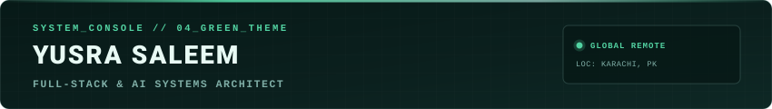

  
  
  
  

> "Bridging transactional SaaS stability with autonomous AI reasoning to engineer deterministic systems that scale."

---

### Industry Background & Credentials

- **Credential:** Certified Agentic AI & Generative AI Developer, GIAIC Initiative (2025 - Present)
- **Full Stack & AI Engineer (Freelance / Client Solutions, 2024 - Present):** Architecting production SaaS platforms, high-concurrency booking engines, and scalable e-commerce systems. Developing deterministic RAG pipelines and autonomous multi-agent workflows using Next.js 15, FastAPI, and PostgreSQL.
- **Advanced Group of Engineering Inc. (AGEI, Present):** Contributing to enterprise software delivery, multi-agent workflow automation, and scalable full-stack web infrastructure.

---

### Engineering Capabilities

| Domain | Core Stack & Frameworks |
| :--- | :--- |
| **Autonomous AI Systems** | OpenAI Agents Python SDK, Multi-Agent Swarms, Model Context Protocol (MCP), Qdrant Vector DB, Deterministic RAG |
| **Production Frontend** | Next.js 15 (App Router, Server Actions), React 19, TypeScript, Tailwind CSS, Framer Motion |
| **Backend & APIs** | Python, FastAPI, Node.js, Express, RESTful Microservices, JWT Authentication, RBAC |
| **Database & Vector Engines** | PostgreSQL (Neon / Supabase), Qdrant Vector DB, Prisma ORM, SQLModel, MongoDB |
| **Cloud & DevOps Delivery** | Docker, Git / GitHub Actions CI/CD, AWS (EC2, S3), Vercel, Postman |

---

### Flagship Systems & Production Repositories

| System | Architecture & Tech Stack | Engineering Scope | Release |
| :--- | :--- | :--- | :--- |
| **[yusrasaleem.dev](https://github.com/Yusra-Saleem/yusrasaleem.dev)** | Next.js 15, Tailwind CSS, Framer Motion | High-performance 120 FPS personal engineering console | `Production` |
| **[operator-one](https://github.com/Yusra-Saleem/operator-one)** | OpenAI Agents SDK, Python FastAPI, PostgreSQL | Business AI automation agent & operations console | `v1.0.0` |
| **[openai-agent-sdk](https://github.com/Yusra-Saleem/openai-agent-sdk)** | OpenAI Agents SDK, Python, PostgreSQL, Next.js | Realtime voice & AI business assistant modules | `v1.0.0` |
| **[elite-motors](https://github.com/Yusra-Saleem/elite-motors)** | Next.js, FastAPI, PostgreSQL, AWS Cloud | Full-stack dealership management SaaS platform | `v1.0.0` |
| **[ai-robotics-book](https://github.com/Yusra-Saleem/ai-robotics-book)** | Docusaurus, Qdrant Vector DB, FastAPI | Interactive AI book & deterministic RAG knowledge engine | `v1.0.0` |

---

### Direct Inquiries

- **Portfolio:** [yusrasaleem.dev](https://yusrasaleem.dev)
- **LinkedIn:** [linkedin.com/in/yusra-saleem-dev](https://www.linkedin.com/in/yusra-saleem-dev)
- **Direct Email:** [yusrasaleem679@gmail.com](mailto:yusrasaleem679@gmail.com)
