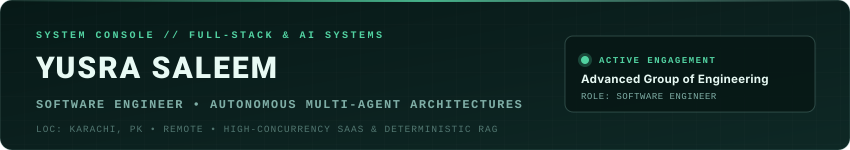

  <a href="https://yusrasaleem.dev">Website</a> &bull;
  <a href="https://www.linkedin.com/in/yusra-saleem-dev">LinkedIn</a> &bull;
  <a href="mailto:yusrasaleem679@gmail.com">Email</a> &bull;
  <a href="https://x.com/Yusra96215">X (Twitter)</a>

Software Engineer specializing in scalable full-stack SaaS platforms and autonomous multi-agent systems. Currently engineering production web software at **Advanced Group of Engineering Inc.**, focusing on type-safe backends with FastAPI and PostgreSQL, and high-concurrency web frontends with Next.js 15.

---

### Architectural Pillars

- **Autonomous Multi-Agent Orchestration:** Designing self-healing agent swarms using the OpenAI Agents SDK and Model Context Protocol (MCP) with deterministic exception handling and self-correcting tool loops.
- **High-Performance Full-Stack SaaS:** Building responsive, type-safe full-stack platforms using Next.js 15 (App Router, Server Actions), FastAPI, and PostgreSQL with strict relational integrity.
- **Deterministic Knowledge Ingestion:** Engineering retrieval-augmented generation (RAG) microservices powered by Qdrant Vector DB, semantic search, and verified citations.

---

### Flagship Systems & Production Repositories

| System | Architecture & Tech Stack | Engineering Scope | Release |
| :--- | :--- | :--- | :--- |
| **[yusrasaleem.dev](https://github.com/Yusra-Saleem/yusrasaleem.dev)** | Next.js 15, Tailwind CSS, Framer Motion | High-performance 120 FPS personal engineering console | `Production` |
| **[operator-one](https://github.com/Yusra-Saleem/operator-one)** | Next.js, TypeScript, Autonomous Workflows | Multi-agent operations console & task execution engine | `v1.0.0` |
| **[openai-agent-sdk](https://github.com/Yusra-Saleem/openai-agent-sdk)** | Python, OpenAI Agents SDK, Tool Calling | Production multi-agent routing modules & handoffs | `v1.0.0` |
| **[ai-book-backend](https://github.com/Yusra-Saleem/ai-book-backend)** | Python, FastAPI, Qdrant Vector DB, Docker | Vector search & knowledge ingestion microservice | `v1.0.0` |
| **[hotel-management-system](https://github.com/Yusra-Saleem/hotel-management-system)** | Next.js, TypeScript, Tailwind CSS, PostgreSQL | High-concurrency room reservation & hospitality SaaS | `v1.0.0` |
| **[elite-motors](https://github.com/Yusra-Saleem/elite-motors)** | Next.js, React, TypeScript, Tailwind CSS | Luxury automotive dealership & booking platform | `v1.0.0` |
| **[online-shopping-store](https://github.com/Yusra-Saleem/online-shopping-store)** | Next.js, TypeScript, Tailwind CSS, Stripe | Multi-category shopping cart & digital retail storefront | `v1.0.0` |
| **[todo-app](https://github.com/Yusra-Saleem/todo-app)** | Next.js 15, React, TypeScript, Tailwind CSS | Full-stack operations management SaaS with real-time state | `v1.0.0` |

---

### Technical Capabilities

| Domain | Core Technologies & Frameworks |
| :--- | :--- |
| **AI & Multi-Agent Systems** | OpenAI Agents Python SDK, Multi-Agent Swarms, Model Context Protocol (MCP), Qdrant Vector DB, Deterministic RAG |
| **Frontend Architecture** | Next.js 15 (App Router), React 19, TypeScript, JavaScript, Tailwind CSS, Framer Motion, HTML5, CSS3 |
| **Backend & APIs** | Python, FastAPI, Node.js, Express, RESTful APIs, JWT Authentication, RBAC |
| **Databases & Vector Storage** | PostgreSQL, Qdrant Vector DB, Prisma ORM, SQLModel, Supabase, MongoDB |
| **DevOps & Infrastructure** | Docker, Git, GitHub Actions CI/CD, AWS (EC2, S3), Vercel, Postman |

---

### Professional Overview

- **Software Engineer &mdash; Advanced Group of Engineering Inc. (Present)**  
  Engineering scalable web applications, enterprise client solutions, and autonomous multi-agent workflows using Next.js 15, FastAPI, and PostgreSQL. Focused on deterministic tool calling and exception recovery.
- **Certified Agentic AI & Generative AI Developer &mdash; GIAIC Initiative**  
  Advanced certification covering agentic intelligence, autonomous multi-agent architectures, and production cloud AI integration.
- **Bachelor of Science in Computer Science (BSCS)**  
  Core computer science foundation covering algorithms, data structures, database architecture, and distributed systems.

---

### Verified Channels

- **Portfolio:** [yusrasaleem.dev](https://yusrasaleem.dev)
- **LinkedIn:** [linkedin.com/in/yusra-saleem-dev](https://www.linkedin.com/in/yusra-saleem-dev)
- **Email:** [yusrasaleem679@gmail.com](mailto:yusrasaleem679@gmail.com)
